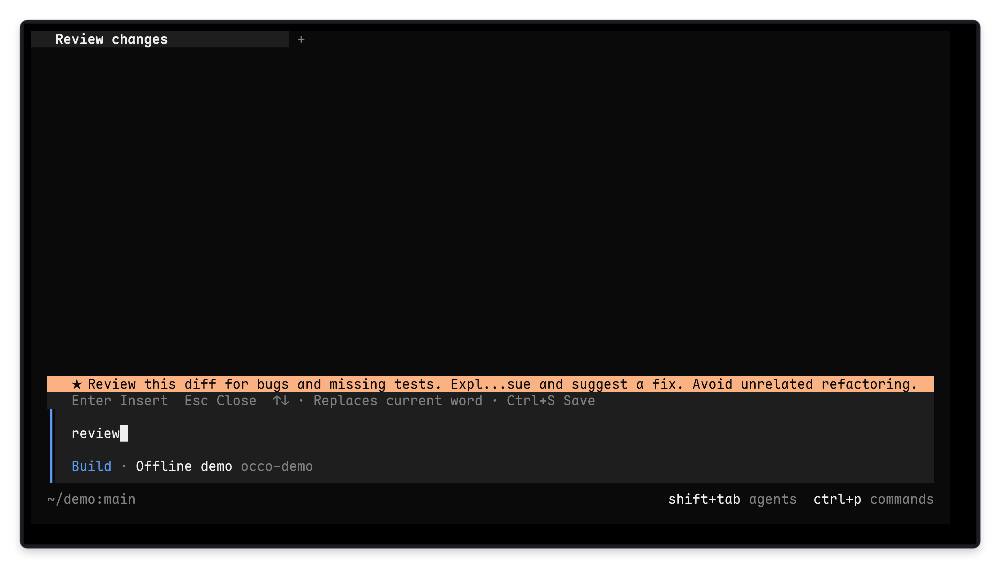

<h1>
  <picture>
    <source media="(prefers-color-scheme: dark)" srcset="docs/brand/header-dark.svg">
    
  </picture>
</h1>

English · [简体中文](README.zh-CN.md)

Tired of scrolling back to copy a reply?<br>
Tired of retyping the same prompts?

**OCCO adds autocomplete to OpenCode, with suggestions from your current conversation and saved prompts.** Type a few characters, choose a suggestion, and press Enter to insert it.

## Reuse the conversation

Type the first few letters of a sentence from an earlier reply to autocomplete it, without scrolling back to copy.

[](docs/conversation-en.png)

## Reuse your prompts

Save prompts you reuse often. Next time, type the first few letters to autocomplete the full prompt.

[](docs/library-en.png)

## Install

For **OpenCode 2.3.0+**.

With Bun 1.4.3, run from the repository root:

```sh
bun install --frozen-lockfile
cd packages/occo
bun run build
```

Or extract `occo-0.1.0.tgz` and enter its `package` directory—no build needed. Use this project's source or archive, not the unrelated `occo` package on npm.

From the plugin directory (`packages/occo` or the extracted `package`), generate its configuration:

```sh
bun -e "console.log(JSON.stringify({plugins:[require('node:url').pathToFileURL(process.cwd()).href]},null,2))"
```

Add the file URL to `plugins` in your OpenCode configuration environment's `cli.json`, keeping existing entries. Use the **package directory**, not `dist/tui.js`, then restart OpenCode. Remove the entry to disable OCCO.

## Use

Type three English letters or two Chinese characters to get matching suggestions.

| Action | How |
| --- | --- |
| Choose and insert | ↑/↓, then Enter |
| Close suggestions | Esc |
| Open or close the menu manually | F12 |
| Save your draft | Command palette → occo → **Save current prompt**, then Ctrl+S |
| Reuse a saved prompt | Command palette → occo → **Open prompt library**, then Ctrl+R |

**Enter inserts while the menu is open. Press Esc first if you want to send.** Saved prompts need no title. Insertion takes one undo step; replacement takes two.

Prompts are stored locally. Conversation suggestions use the current session's last ten completed messages. Generating suggestions makes no model calls.

[Usage details](docs/usage.md) · [Contributing](CONTRIBUTING.md) · [Tests and limitations](VALIDATION.md)

[MIT License](LICENSE) · [Third-party notices](THIRD_PARTY_NOTICES.md)
