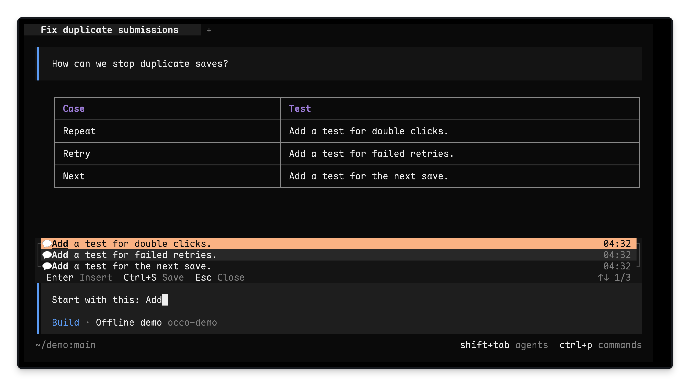

<h1>
  <picture>
    <source media="(prefers-color-scheme: dark)" srcset="docs/brand/header-dark.svg">
    
  </picture>
</h1>

English · [简体中文](README.zh-CN.md)

Tired of scrolling back to copy a reply?<br>
Tired of retyping the same prompts?

**OCCO adds autocomplete to OpenCode, with suggestions from your current conversation and saved prompts.** Type a few characters, choose a suggestion, and press Enter to insert it.

## Reuse the conversation

Type a few characters from an earlier reply—even inside a Markdown table—to continue from the match to the end of that sentence or cell fragment. Code completes from the matched character to the end of its block.

[](docs/conversation-en.png)

## Reuse your prompts

Save prompts you reuse often. Next time, type the first few letters to autocomplete the full prompt.

[](docs/library-en.png)

## Install

For **OpenCode 2.3.0+**.

Install directly with OpenCode:

```sh
opencode plugin add @lyl-build/occo
```

OpenCode installs the plugin and registers it in your configuration. Restart OpenCode, then type a few characters to see suggestions. `opencode plugin list` shows installed plugins, `opencode plugin update` upgrades to the latest release, and `opencode plugin remove @lyl-build/occo` uninstalls.

### Offline or from source

Installing the package with npm alone does not register the plugin—OpenCode never scans `node_modules`. For an offline or source install, build with Bun 1.4.3 from the repository root:

```sh
bun install --frozen-lockfile
cd packages/occo
bun run build
```

Run `npm pack @lyl-build/occo` instead to get `lyl-build-occo-0.2.1.tgz` with the same files—extract it and skip the build.

From the plugin directory (`packages/occo`, `node_modules/@lyl-build/occo`, or the extracted `package`), generate its configuration:

```sh
bun -e "console.log(JSON.stringify({plugins:[require('node:url').pathToFileURL(process.cwd()).href]},null,2))"
```

Add the file URL to `plugins` in your OpenCode configuration environment's `cli.json`, keeping existing entries. Use the **package directory**, not `dist/tui.js`, then restart OpenCode. Remove the entry to disable OCCO.

## Use

Type three English letters or two Chinese characters to get matching suggestions. 💬 completes conversation text from the match; ⭐ inserts a saved prompt in full. Use ↑/↓ to browse every match, within an eight-row viewport, with up to three preview rows per match.

| Action | How |
| --- | --- |
| Choose and insert | ↑/↓, then Enter |
| Close suggestions | Esc |
| Open or close the menu manually | F12 |
| Save your draft | Command palette → occo → **Save current prompt**, then Ctrl+S |
| Reuse a saved prompt | Command palette → occo → **Open prompt library**, then Ctrl+R |

**Enter inserts while the menu is open. Press Esc first if you want to send.** Saved prompts need no title. Insertion takes one undo step; replacement takes two.

Prompts are stored locally. Conversation suggestions use all completed user and assistant messages in the current session, appearing as history pages load.

[Usage details](docs/usage.md) · [Contributing](CONTRIBUTING.md) · [Tests and limitations](VALIDATION.md)

[MIT License](LICENSE) · [Third-party notices](THIRD_PARTY_NOTICES.md)
