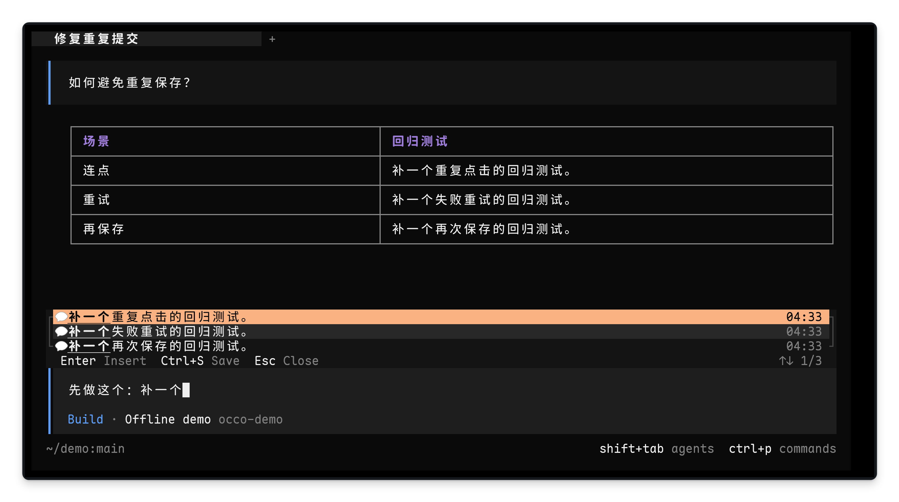
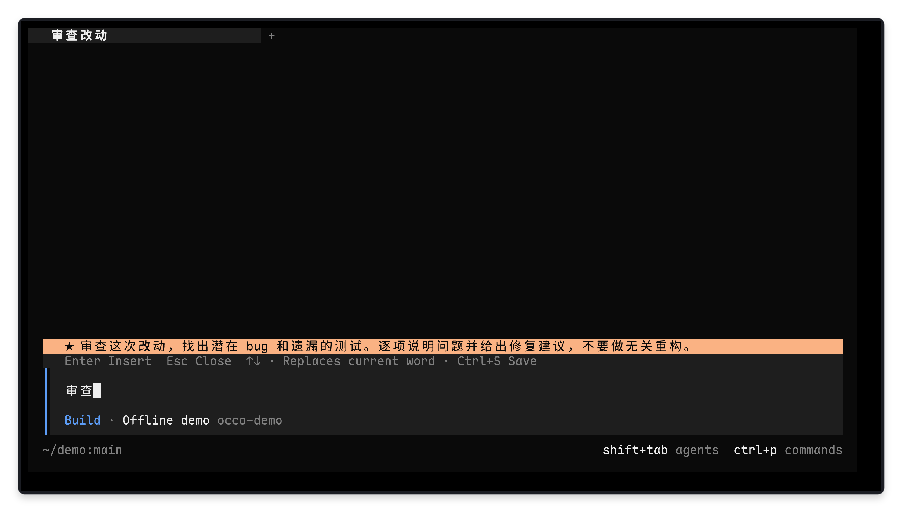

<h1>
  <picture>
    <source media="(prefers-color-scheme: dark)" srcset="docs/brand/header-dark.svg">
    
  </picture>
</h1>

[English](README.md) · 简体中文

厌倦了为了复制一段回复而来回翻找？<br>
厌倦了一遍遍输入同样的提示词？

**OCCO 为 OpenCode 提供自动补全，建议来自当前对话和已保存的提示词。** 输入几个字，选中建议，按 Enter 插入。

## 复用对话

输入之前回复中的几个字，即可从命中处补全到当前句子或表格单元格片段的末尾，不必回头翻找复制。代码从命中字符补全到代码块末尾。

[](docs/conversation-zh.png)

## 复用提示词

将经常复用的提示词保存起来，下次只需输入前两字，就能自动补全完整提示词。

[](docs/library-zh.png)

## 安装

适用于 **OpenCode 2.3.0+**。

安装 Bun 1.4.3 后，在仓库根目录运行：

```sh
bun install --frozen-lockfile
cd packages/occo
bun run build
```

也可以从 npm 安装 `@lyl-build/occo`，直接使用安装目录，无需构建。运行 `npm pack @lyl-build/occo` 可生成 `lyl-build-occo-0.2.0.tgz`，内容相同，适合离线使用。

在插件目录（`packages/occo`、`node_modules/@lyl-build/occo` 或解压后的 `package`）生成配置：

```sh
bun -e "console.log(JSON.stringify({plugins:[require('node:url').pathToFileURL(process.cwd()).href]},null,2))"
```

将文件 URL 加入当前 OpenCode 配置环境的 `cli.json` 中的 `plugins` 数组，保留已有条目。路径应指向**包目录**，不是 `dist/tui.js`。重启 OpenCode 即可加载，删除该条目即可禁用。

## 使用

输入三个英文字母或两个汉字，即可查找匹配建议。💬 从命中处补全对话片段；⭐ 插入完整的已保存提示词。↑/↓ 可以浏览全部结果，候选区最多占八行，每条预览最多三行。

| 操作 | 方式 |
| --- | --- |
| 选择并插入 | ↑/↓，然后 Enter |
| 关闭建议 | Esc |
| 手动开关菜单 | F12 |
| 保存当前草稿 | 命令面板 → occo → **Save current prompt**，再按 Ctrl+S |
| 插入已保存的提示词 | 命令面板 → occo → **Open prompt library**，再按 Ctrl+R |

**菜单打开时，Enter 用于插入。想发送草稿，请先按 Esc。** 保存提示词不用起标题；插入只需一步撤销，替换需要两步。

提示词保存在本地。对话建议检索当前会话中所有已完成的用户消息和助手回复，历史每加载一页就提供对应结果。

[使用细节](docs/usage.zh-CN.md) · [参与贡献](CONTRIBUTING.md) · [测试与限制](VALIDATION.md)

[MIT 许可证](LICENSE) · [第三方声明](THIRD_PARTY_NOTICES.md)
